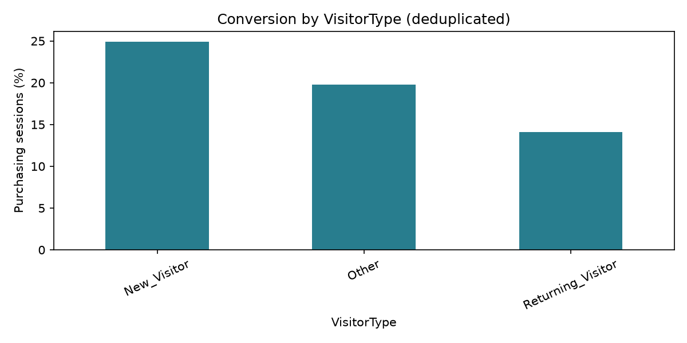
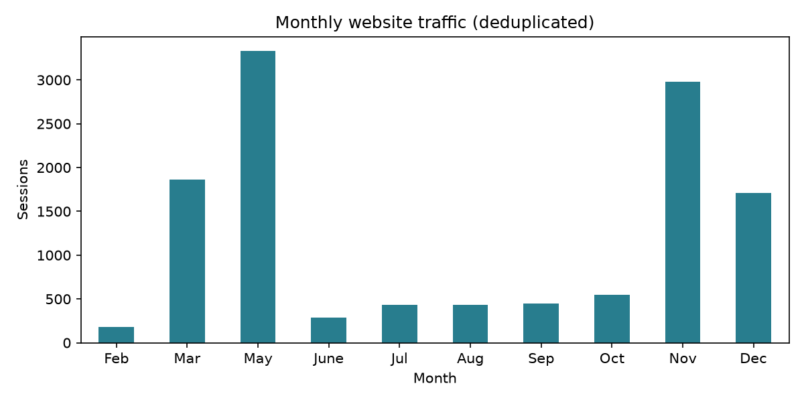

# Shopper Signals

A reproducible Online Shoppers Purchasing Intention portfolio MVP: audited exploratory analysis, Logistic Regression and Random Forest classifiers, and an interactive Streamlit dashboard for conversion insights and experimental purchase prediction.

[GitHub repository](https://github.com/haithamalfraidi-eng/online-shoppers-purchasing-intention). Live deployment is pending Streamlit account access; no public application URL has been verified.

## Run locally

Use Python 3.11. From this directory:

```bash
python -m venv .venv
# Windows PowerShell:
.venv\Scripts\Activate.ps1
# macOS/Linux: source .venv/bin/activate
python -m pip install -r requirements-dev.txt
python -m shopper.analyze
python -m shopper.train
python -m pytest -q
python scripts/verify_runtime.py
python -m streamlit run app.py
```

The trusted trained artifact and analysis outputs are included, so the dashboard can run immediately after installing requirements. Rebuild the artifact after changing dependency versions or data. Never load untrusted joblib/pickle files.

## What was preserved and completed

`original/01_data_understanding.py` is a byte-for-byte snapshot of the analysis when this project started. `data/online_shoppers_intention.csv` is a byte-for-byte copy of the original dataset; the source files outside this project remain untouched. A later edit made during implementation is separately preserved as `original/01_data_understanding_latest.py`, with checksums in `original/preservation_manifest.json`. That later version adds a `City` / `Order_amount` query; neither column exists in this dataset, so it is preserved for reference but excluded from the executable pipeline. The original script expects the CSV in its working directory; to run the initial snapshot unchanged, copy it to a temporary directory alongside a copy of the CSV. The organized replacement is `python -m shopper.analyze`.

The original visitor conversion, monthly traffic, May/November engagement, and duration IQR questions are reused. The completed workflow validates schema, saves separate figures and tables, distinguishes raw from cleaned data, and retains long-duration observations. The original script had no active missing-value or duplicate-removal step; those checks are now explicit.

## Data audit and descriptive findings

The supplied file contains 12,330 sessions, 18 columns, no missing cells, and 125 exact duplicate rows. Removing exact duplicates leaves 12,205 records and 1,908 purchasing sessions. Raw conversion is 15.47%; deduplicated conversion is 15.63%. Exact duplicates may be legitimate indistinguishable sessions; removing them is an explicit modeling choice that slightly changes the population.

In the deduplicated data:

| Segment | Sessions | Purchasing sessions | Conversion |
| --- | ---: | ---: | ---: |
| New visitor | 1,693 | 422 | 24.93% |
| Returning visitor | 10,431 | 1,470 | 14.09% |
| Other | 81 | 16 | 19.75% |
| May | 3,329 | 365 | 10.96% |
| November | 2,982 | 760 | 25.49% |

Returning visitors account for more purchasing sessions even though new visitors have a higher conversion rate. November has a higher observed conversion rate than May despite lower session volume. These associations motivate investigating acquisition mix and funnel behavior; they do not show that changing visitor mix or season causes uplift. The Other segment is small. No sales uplift, ROI, or monetary impact is estimated.




## Evaluation design

1. Validate the schema and remove exact duplicate rows before splitting. Tests verify that identical model feature vectors do not cross partitions in this dataset.
2. Use stratified 60/20/20 train/validation/test partitions with seed 42: 7,323 / 2,441 / 2,441 records. Exact row indices, prevalence, versions, and dataset SHA-256 are recorded in `artifacts/metrics.json`.
3. Fit all imputation, numeric scaling, and one-hot encoding inside a scikit-learn pipeline on training data only. Treat OS, browser, region, and traffic IDs as categories. Unknown categories are supported.
4. Train fixed Logistic Regression and Random Forest configurations plus a prior-only dummy baseline. No resampling or test-driven hyperparameter search. Random Forest uses 250 trees and minimum leaf size 4; Logistic Regression uses default regularization and a 3,000-iteration limit.
5. Choose the model by validation average precision. For each non-dummy model, choose the threshold maximizing validation F1 over 0.05–0.80 in 0.005 increments. This optimizes a statistical metric, not a business-cost objective. Dummy uses 0.5.
6. Freeze models and thresholds before evaluating the test set. The deployed artifact remains trained on the training partition; it is not refit after evaluation. No production outcomes have been measured.

Full-data EDA preceded modeling and informed the project. The test set is held out from training and threshold/model selection, but it is not a completely blinded independent scientific validation. One random split has sampling uncertainty; no confidence intervals or future-period performance claims are made.

### Test results: PageValues excluded

The positive class is `Revenue=True`. Test prevalence is 15.65% (382 / 2,441). PR-AUC below means **average precision (AP)**, not trapezoidal area under the PR curve.

| Model | Precision | Recall | F1 | ROC-AUC | PR-AUC (AP) | Threshold |
| --- | ---: | ---: | ---: | ---: | ---: | ---: |
| Prior dummy | 0.0000 | 0.0000 | 0.0000 | 0.5000 | 0.1565 | 0.500 |
| Logistic Regression | 0.2900 | 0.7304 | 0.4152 | 0.7502 | 0.3295 | 0.175 |
| **Random Forest — selected** | **0.3217** | **0.6728** | **0.4352** | **0.7813** | **0.3694** | **0.200** |

The dummy predicts no purchases at its threshold; undefined precision is explicitly reported as zero. Random Forest's test confusion matrix is below. Modest precision means many false positive purchase predictions; this MVP is not suitable for automated marketing spend decisions.

| Actual / predicted | No purchase | Purchase |
| --- | ---: | ---: |
| No purchase | 1,517 | 542 |
| Purchase | 125 | 257 |

Machine-readable results: [`metrics.csv`](artifacts/metrics.csv), [`metrics.json`](artifacts/metrics.json), and [`test_predictions.csv`](artifacts/test_predictions.csv). The dashboard includes ROC/PR curves and a confusion matrix.

## Leakage and limits

**PageValues is excluded from the deployed model.** UCI describes it as an average page value associated with visits before an e-commerce transaction. Its transaction-derived construction and unknown computation window create a potential target/temporal leakage risk. We cannot prove whether a given value was available before a purchase decision. Exclusion is a conservative decision, not proof that all published benchmarks using it are invalid.

A separately labeled sensitivity experiment on the same partitions includes PageValues and fits/selects thresholds on train/validation only:

| Model with PageValues | Precision | Recall | F1 | ROC-AUC | PR-AUC (AP) |
| --- | ---: | ---: | ---: | ---: | ---: |
| Logistic Regression | 0.6352 | 0.6518 | 0.6434 | 0.9013 | 0.6592 |
| Random Forest | 0.5967 | 0.7670 | 0.6712 | 0.9267 | 0.7416 |

The large improvement warrants investigation; it does not prove valid prospective performance. These models cannot be selected for the dashboard.

**Other fields also have timing risks.** Page counts, durations, bounce and exit rates may summarize a completed session or aggregated analytics unavailable at decision time. No event timestamps or feature provenance allow a point-in-time audit. This app is a retrospective session classifier and scenario explorer. A real-time system needs timestamped feature snapshots collected before the decision, followed by future-period validation.

UCI describes different users across sessions, but this CSV has no user IDs to verify independence or support grouped evaluation. It covers one historical year and has no exact timestamps, so chronological splitting and store-level generalization cannot be established. January/April are absent; month comparisons do not represent a complete annual trend. Historical behavior may not match current customers. Revenue is a Boolean outcome, not sales value. No calibration study, causal experiment, cost model, intervention trial, or fairness audit has been performed. Model scores are not guaranteed calibrated probabilities.

## Dashboard

- **Conversion insights:** month/visitor filters, cohort counts and rates, monthly traffic, May/November engagement, CSV download, and clear empty-state handling.
- **Purchase prediction:** editable session scenario using training-only defaults; no PageValues input; selected model score and frozen decision threshold; out-of-range notice.
- **Model evaluation:** both models and baseline, test metrics, ROC/PR curves, confusion matrix, and labeled PageValues sensitivity.
- **Data & limitations:** prediction timing, uncertainty, leakage, and attribution.

## Tests and reproduction

`python -m pytest -q` passes **15 tests** covering dataset integrity, idempotent cleaning, partition independence, training-only preprocessing, unseen categories, missing numeric values at inference, target/PageValues exclusion, recomputation of every reported metric, validation-only model/threshold selection, invalid input rejection, conversion counts, and Streamlit prediction/empty-filter behavior. The recorded run is in `reports/test-results.xml`.

Requirements were installed in a fresh Python 3.11 virtual environment and checked with `pip check`. The same suite also runs in that environment. `scripts/verify_runtime.py` starts the actual Streamlit server and checks the homepage and health endpoint return HTTP 200. Runtime evidence is in `reports/runtime_verification.json`; the verified dependency versions are recorded in `reports/verified-environment.txt`.

Retraining in that fresh environment reproduced every saved test prediction exactly (`reports/reproduction_verification.json`). Git attributes disable newline conversion for the original scripts and dataset so cloning preserves their byte-level checksums.

A fresh clone from the published GitHub repository also passed all 15 tests and the actual Streamlit HTTP startup checks.

Reproduction commands overwrite generated outputs only; original files are not modified. Retraining is explicit and is not triggered by dashboard visitors.

## Structure

```text
app.py                    Streamlit dashboard
shopper/data.py           Schema checks, cleaning, conversion tables
shopper/analyze.py        Original analysis questions organized into outputs
shopper/train.py          Pipelines, validation selection, holdout evaluation
original/                 Unmodified original Python analysis
data/                     Unmodified supplied CSV
artifacts/                Trusted model, metrics, predictions, partition indices
reports/                  Audit, analysis tables, figures, verification
tests/                    Data/model/dashboard tests
```

## Deploy

In [Streamlit Community Cloud](https://share.streamlit.io/), connect the GitHub repository, choose branch `main`, entry point `app.py`, and Python 3.11 in Advanced settings. The root `requirements.txt` installs runtime dependencies. See [Streamlit's deployment instructions](https://docs.streamlit.io/deploy/streamlit-community-cloud/deploy-your-app/deploy). GitHub Pages cannot execute this Python application.

## Source and attribution

Sakar, C. & Kastro, Y. (2018). *Online Shoppers Purchasing Intention Dataset*. UCI Machine Learning Repository. [DOI: 10.24432/C5F88Q](https://doi.org/10.24432/C5F88Q). Dataset is provided unchanged under [CC BY 4.0](https://creativecommons.org/licenses/by/4.0/); analysis and derived outputs are new. [Official dataset documentation](https://archive.ics.uci.edu/dataset/468/online+shoppers+purchasing+intention+dataset) supplies feature definitions and collection limitations.
